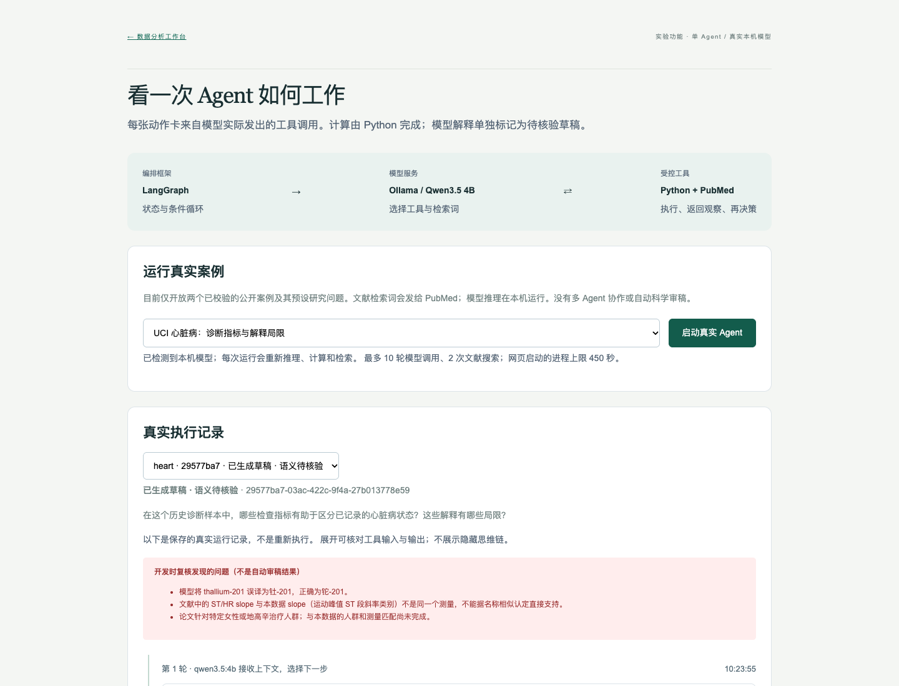

# OpenResearch Agent

**面向科研分析的证据可追溯 Agent 系统**

[English README](README.en.md) · [GitHub 仓库](https://github.com/tired-wind/openresearch-agent)

> 进度更新：2026 年 10 月 23 日（新加坡时间）。
>
> 现在有两个明确区分的入口：原工作台执行固定的数据分析流程；新增 `/agent` 使用 **LangGraph + Ollama + Qwen3.5 4B**，让真实模型选择工具、检索文献并提交解释草稿。**已接通单 Agent 工具循环，尚未实现完整科学语义核验、多 Agent 协作或参赛合规。**
>
> **交接必读**：[2026-10-23 开发日志](docs/dev-log-2026-10-23.md) — 三层接入现状、实测证据、复现步骤、已知问题与待办。

## 先看 Agent 如何工作

启动应用后打开 **[真实 Agent 演示](http://127.0.0.1:3018/agent)**。点击“启动真实 Agent”会进行新的本机推理；选择历史记录则查看已保存的真实执行证据。

- **框架**：LangGraph 管理模型与工具的条件循环。
- **模型**：Ollama 提供本机 Qwen3.5 4B 推理，决定工具、检索词、阅读对象和结束时机。
- **工具**：Python 检查与建模、PubMed 搜索与摘要读取、结果身份校验与草稿保存。
- **边界**：目前只开放两个已校验的 UCI 公开案例及预设问题；解释为待核验草稿。

一次实际网页运行中，模型先检查和分析数据；第一次检索返回零条记录，它改变检索词再次搜索，再读取两篇摘要；提交时传错特征名称，程序拒绝后，模型改成实际字段名才完成。这些动作均可在页面展开查看。

[工程对照与架构](docs/agent-engineering.md)说明从 PilotDeck / OpenWorker 学到的具体设计；[真实运行记录及已发现错误](docs/agent-acceptance.md)说明这次 Demo 能证明什么、不能证明什么。旧版六阶段是固定流程，不再把它称作六个独立 Agent。



## 赛道三层：已接入并实测

比赛要求 DATA / BUILD / POWER 三层同时落地，且不是"提到"而是"跑通一个真实功能"。三层的接入代码与自检脚本：

| 层 | 技术 | 实现 | 自检 |
|---|---|---|---|
| DATA | **Zetaris** | `backend/zetaris.py`：直连 REST 执行只读 SQL，带 `X-Org-ID` / 每次新 `X-Request-ID`，写操作在发出前拒绝 | `python scripts/check_zetaris.py` |
| BUILD | **Meterless H-MEM** | `backend/hmem.py`：八信号混合检索、强制 `source`、信任账本、跨会话记忆；接入研究循环 | `python scripts/check_hmem.py` |
| POWER | **NVIDIA Nemotron**（经 Meterless Nightshift） | `backend/llm.py` + `NightshiftProvider`：OpenAI 兼容路由，记录实际服务的模型 | `python scripts/check_power.py` |

实测证据：Zetaris `SELECT 1` 与 `SHOW LIGHTNING DATABASES` 通过；`meterless/auto` 实际路由到 `nvidia/nemotron-3.5-lightning-30b-a3b` 并完成推理；H-MEM 第二会话能召回第一会话写入的事实。三层的设计取舍与未实现项见 [Zetaris](docs/zetaris.md)、[H-MEM](docs/hmem.md)。

模型调用失败、Zetaris 不可达、记忆为空时，系统仍走原有确定性路径并保留不确定性说明，不会伪造结果。

## 1. 项目要解决什么问题

目标用户是需要分析结构化数据，并把模型结果与科学文献结合起来的研究人员和数据分析人员。

用户提供 CSV 或 XLSX 数据集、研究问题及目标变量，系统执行实际 Python 分析，展示模型评估与特征重要性，再检索相关科学文献，输出能够追溯到计算文件和文献记录的报告。

设计原则：数值来自可执行代码；引用来自真实检索；证据不足时保留不确定性。特征重要性不等于因果关系，检索到论文也不等于论文支持结论。

## 2. 当前工作进度

| 模块 | 状态 | 已完成内容与剩余工作 |
|---|---|---|
| 规则与环境审计 | 部分完成 | 已检查公开规则、本机环境和公开资源文档；登录后的 Resources 内容尚未完成审计 |
| 数据上传与检查 | 已实现并测试 | CSV/XLSX 解析、文件大小限制、字段检查、缺失值和重复行检查 |
| 机器学习分析 | 已实现并测试 | 分类/回归、训练测试分离、训练集内预处理、三折交叉验证、基线比较、排列重要性 |
| 泄漏检查 | 已实现基础检查 | 排除标识符、常量、高基数文本及明显目标副本；无法保证发现所有业务层面的泄漏 |
| 文献检索 | 已接通并实测 | PubMed 搜索和摘要获取；保留 PMID、DOI（若有）、作者、年份及来源链接 |
| 文献证据判断 | 原文定位已实现，语义判断待完成 | 结论证据卡绑定计算与摘要字符位置；词语命中仅为待审查线索，不自动判断支持或反驳 |
| 执行流程与状态 | 已实现并测试 | 运行前方案预览、目的/设计拦截、输入指纹、六阶段状态、超时、历史记录与刷新恢复 |
| LLM 与 Agent 推理 | 单 Agent 实验入口已接通 | LangGraph + 本机 Qwen 工具循环已实跑；多 Agent、任意问题规划与语义审核未完成 |
| 研究工作台 | 已实现并测试 | 中文主流程、一键公开案例、字段释义、方案预览、可展开证据卡、报告；支持桌面及手机布局 |
| 报告与导出 | 已实现并测试 | Markdown 报告、JSON 证据包，以及本地中间文件 |
| Zetaris / Meterless | 接入受阻 | 尚未验证比赛提供的实际接口、凭据和运行环境，未实现真实集成 |
| NVIDIA Nemotron | 尚未接入 | 已查阅公开资料；没有已验证的可用推理服务 |
| 参赛交付 | 尚未完成 | 已建立 GitHub 公开协作仓库和任务清单；实际 Cursor 开发记录、演示视频、幻灯片及最终提交仍待完成 |

**原工作台的方案仍由规则生成；新 Agent 入口独立运行。** 用户选择研究目的与数据设计；系统检查目标、样本和少量范围关键词，不支持的设计会被拦截，但不能理解任意科学意图。公开案例提供默认目标和检索词；一般上传仍需用户定义。六个执行阶段不代表六个独立的大模型 Agent。

## 3. 应该怎样验收

| 你检查的行为 | 当前结果 | 证据与限制 |
|---|---|---|
| 模型是否真的调用工具 | 已发生 | `/agent` 展示实际工具名、参数和返回值；不是预设动画 |
| 没搜到论文时能否调整 | 实跑中发生 | 第一次 0 条后模型换了查询，第二次获取 2 篇记录 |
| 模型传错参数怎么办 | 拒绝并反馈 | 中文特征描述被拒绝，模型改用真实字段名后重新提交 |
| 数字是否来自实际计算 | 指标和排序来自 Python | 训练/测试、基线、模型结果和重要性可查看；模型自由文本仍可能出错 |
| 论文是否真的支持解释 | **尚未通过验收** | 已发现测量名称混淆和术语误译；引用存在不等于支持成立 |
| 模型不可用时怎么办 | 明确不可用 | 禁用启动，不自动下载或切换付费服务 |

[真实 Agent 验收](docs/agent-acceptance.md)保留成功动作与失败案例。[原工作台验收](docs/product-acceptance.md)和[底层测试记录](docs/test-results.md)用于检查计算与交互，不作为科研智能或临床效果证明。

## 4. 原工作台架构与新增 Agent 运行时

```text
研究者：数据集 + 研究问题 + 目标变量
                  ↓
Next.js / TypeScript 研究工作台
                  ↓
FastAPI / Pydantic 输入验证
                  ↓
有容量限制的本地任务队列
                  ↓
Python 子进程：规划 → 数据检查 → 建模 → 文献检索 → 审核 → 报告
                  ↓
SQLite 执行状态 + 本地分析文件
                  ↓
结果展示 / Markdown 报告 / JSON 证据导出
```

| 层次 | 当前实现 |
|---|---|
| 前端 | Next.js、React、TypeScript、普通 CSS；未引入 Tailwind |
| 后端 | Python 3.12、FastAPI、Pydantic |
| 数据与建模 | pandas、NumPy、scikit-learn |
| 模型 | 随机森林分类器/回归器，与 Dummy 基线比较 |
| 可解释性 | 测试集上的排列重要性，8 次打乱重复；未引入 SHAP |
| 文献 | PubMed / NCBI E-utilities；尚未接入 OpenAlex |
| 编排 | 原工作台为固定顺序流程；新增 `/agent` 为 LangGraph 模型—工具条件循环 |
| 存储 | SQLite、本地上传文件和运行产物 |
| 测试 | pytest、前端构建、Playwright |

当前无需 Redis、Kubernetes、分布式队列或向量数据库。详细设计见 [架构文档](docs/architecture.md)。

每次运行保存 `plan.json`、`overview.json`、`analysis.json`、`literature.json`、`review.json`、`provenance.json` 和 `report.md`，包括数据 SHA-256、训练/测试行索引、随机种子、依赖版本及证据标识。

审核器目前检查数值是否有限、训练测试索引是否交叉、引用标识是否一致；**不替代独立科学审稿，也不验证论文是否支持某个具体结论**。

## 5. 本地启动与演示

### 环境要求

已验证环境为 ARM 架构 macOS、16 GiB 内存、Python 3.12 和 Node.js 24。需要 `uv` 和 `npm`。本地合成数据演示不需要 GPU、Docker、大模型权重或 API 密钥；启用 PubMed 检索时需要网络。

首次在另一台电脑上协作时可克隆公开仓库；推送分支需要接受协作邀请：

```bash
gh repo clone tired-wind/openresearch-agent
cd openresearch-agent
```

已有本地项目则直接进入项目根目录，无需重复克隆。随后执行：

```bash
uv sync --frozen --python 3.12
npm --prefix frontend ci
npm --prefix frontend run build
./scripts/start.sh
```

- 研究工作台：[http://127.0.0.1:3018](http://127.0.0.1:3018)
- 后端接口文档：[http://127.0.0.1:8018/docs](http://127.0.0.1:8018/docs)

这两个地址需要本地服务处于运行状态。启动脚本会检查端口占用，不会主动终止已有服务。服务只绑定本机回环地址。通过该脚本启动后，可用 `Ctrl-C` 停止。

开发时也可以分两个终端启动：

```bash
# 终端一：项目根目录
uv run uvicorn backend.app:app --host 127.0.0.1 --port 8018
```

```bash
# 终端二：项目根目录
npm --prefix frontend run dev
```

### 原工作台演示步骤

主流程、分析方案与证据卡已中文化；完整报告和部分底层方法说明保留英文。无需写代码即可按[产品验收步骤](docs/product-acceptance.md)体验。

1. 点击 **心脏病公开案例 · 303 行**，自动下载校验并设置目标；也可选择明确标记的合成演示。
2. 查看来源、字段含义、缺失及解释边界，确认独立观测。
3. 如需真实文献，启用 PubMed 并检查公开检索词，勿包含个人信息。
4. 点击 **预览分析方案**，检查范围、步骤和限制；不适合的问题会被拦截。
5. 点击 **确认方案并开始分析**，查看实际执行记录。
6. 打开 **结论与证据**，展开卡片查看数值、计算路径及摘要线索。无文献支持时明确保留证据不足。
7. 刷新后恢复结果，或从最近研究打开；在 **研究报告** 中导出 Markdown / JSON。

合成数据采用固定种子生成，按 CC0 提供，不含真实患者记录。重新生成：

```bash
uv run python scripts/generate_demo.py
```

### 真实 Agent 演示的额外条件

本机必须已经运行 Ollama，且 `ollama list` 中有 `qwen3.5:4b`。程序不会自动安装或下载模型。先在原工作台加载公开案例，或运行 `uv run python -m scripts.fetch_public_data heart` 准备公开数据。然后进入 `/agent`，点击启动；也可以运行：

```bash
uv run python -m scripts.run_agent --example heart
```

该入口的模型推理在本机，公开文献查询发往 PubMed；运行失败不会悄悄替换为模拟结果。模型输出与计算事实分开展示，当前不具备自动科学审稿能力。

### 配置与测试

可把 `.env.example` 复制为 `.env`；启动脚本会加载它。`OPENRESEARCH_DATA_DIR` 可指定本地存储目录。密钥不应提交到 Git，也不应粘贴到聊天中。原工作台分析进程不调用 LLM；新 Agent 入口仅调用本机 Ollama，不激活付费 API 或赞助商接口。

```bash
# 后端测试
uv run pytest -q

# 前端构建及类型检查
npm --prefix frontend run build

# 先启动前后端，再运行浏览器测试；使用本机已安装的 Google Chrome
cd frontend
npx playwright test
```

## 6. 当前限制与数据处理边界

- **运行范围：** 本机单用户 MVP。尚未实现用户认证、权限隔离、多租户存储、自动保留期限及面向公网的上传防护，不能直接作为公开医疗数据服务部署。
- **文件范围：** 文件不超过 5 MiB，表格不超过 5,000 行、60 列；XLSX 只读取第一个工作表，不接受公式或外部链接。
- **建模条件：** 去除精确重复行和目标缺失行后至少保留 60 行。分类支持 2–10 类，每类至少 8 行。
- **验证设计：** 仅支持独立观测；暂不支持同一患者多次记录、分组验证、时间序列验证或外部验证。独立性由用户确认，程序不会自动证明。
- **统计解释：** 排列重要性是模型预测依赖程度，不提供因果方向；打乱重复的标准差不是置信区间。小样本及相关特征可能使排名不稳定。
- **评估边界：** 特征筛选基于外层训练集，内部交叉验证是在该筛选结果上进行的；测试集保持分离。使用测试集生成的特征排名属于探索性结果，按排名重新选特征后需要新的验证。
- **文献边界：** 当前获取摘要或元数据，不获取全文；检索失败会明确显示，不生成替代引用。“支持”“反驳”和具体相关性尚未自动判定。
- **隐私与执行：** 原始数据、问题、状态和结果保存在本地；用户启用文献检索后，仅指定检索词发送到 PubMed。不会执行任意 LLM 生成的 Python 代码。
- **容量与恢复：** 同时运行一个分析子进程，运行及排队合计最多 4 个任务，单个子进程限时 150 秒。服务重启会将未完成任务标记为失败；网页刷新后可恢复上次运行状态和报告；本地历史记录保留最近 20 个入口。

上传数据及运行产物默认位于被 Git 忽略的 `data/`。删除该目录会删除上传数据和运行记录，清理前应先导出需要保留的内容。依赖安装在项目 `.venv/` 和 `frontend/node_modules/`；没有安装全局包或下载大模型权重。

该项目拥有独立 Git 仓库，未复制之前项目的产品代码；复用的第三方依赖由 `uv.lock` 和 `frontend/package-lock.json` 锁定。**不要把上级个人助手目录中的私人文件一并发布。**

## 7. 参赛阻塞项与下一步

根据 2026 年 10 月 22 日保存的[规则审计](docs/rules-compliance.md)，参赛项目必须集成 **Zetaris 和 Meterless**，并使用 **Cursor** 开发；还需 GitHub 源码仓库、1–4 分钟演示视频及幻灯片。最终提交前仍应重新核对官方规则。

当前情况：

- 用户已反馈在应用内登录 Resources，但现有工具未能读取该登录会话；比赛提供的额度、接入方法、工作坊与支持资源仍有待核验。
- 尚未完成 Zetaris、Meterless 的真实连接与集成测试。
- Meterless H-MEM 公开资料包含实现规范及非生产参考实现，参考实现使用模拟哈希嵌入；没有把阅读文档或模拟嵌入计作已完成集成。
- 尚未接入可用 LLM，也没有证据证明已通过 Cursor 完成实际开发任务。
- 已建立 GitHub 仓库用于协作；朋友需接受邀请后才能访问。演示视频、幻灯片和参赛提交尚未完成。

下一步按以下顺序推进：

1. 获取 Resources 中不含密钥的页面文字、截图或文档链接，补全资源审计。
2. 验证实际服务地址、认证方法和额度，完成 Zetaris 与 Meterless 最小连接测试。
3. 在可用接口基础上实现有实际用途的集成，并记录可复现的测试证据。
4. 接入受结构化输出约束的 LLM 规划和文献证据审核，保留 Python 数值计算及明确的不确定性边界。
5. 完成实际 Cursor 开发记录、最终测试、演示材料和提交检查。

审计记录中的官方截止时间为 **2026 年 10 月 27 日 23:45 UTC，即新加坡时间 10 月 28 日 07:45**。内部计划争取在新加坡时间 10 月 27 日 18:00 前提交；这属于项目计划，不是已完成事项。

## 8. 文档与代码导航

| 路径 | 内容 |
|---|---|
| [资源审计](docs/resource-audit.md) | 赞助商、科学 API、访问状态和待确认项 |
| [规则审计](docs/rules-compliance.md) | 资格、必需技术、提交要求及合规缺口 |
| [环境审计](docs/environment-audit.md) | 本机配置、工具、项目隔离与运行边界 |
| [开发计划](docs/development-plan.md) | 里程碑和后续任务 |
| [架构文档](docs/architecture.md) | 执行流程、数值计算和证据模型 |
| [测试记录](docs/test-results.md) | 已执行测试、修复记录和验证范围 |
| [演示报告](docs/demo-report.md) | 实际运行输出的报告样例 |
| [演示脚本](docs/demo-script.md) | 待录制视频的流程；不代表视频已完成 |
| [提交清单](docs/submission-checklist.md) | 最终参赛材料及未完成事项 |
| [后端](backend/) / [前端](frontend/) | 应用源码 |
| [自动化测试](tests/) / [浏览器测试](frontend/e2e/) | 后端及端到端验证 |
| [演示数据](demo/) / [辅助脚本](scripts/) | 合成数据说明、生成器和启动脚本 |

审计文档使用 `VERIFIED`（已核验）、`UNVERIFIED`（未核验）和 `BLOCKED`（受阻）区分证据状态。代码已经实现、测试已经通过和完整参赛项目已经完成，是三个不同的进度层次。

## 9. 项目维护与协作

[GitHub 仓库](https://github.com/tired-wind/openresearch-agent)当前公开。已向 `znh3012107` 发送 write 权限邀请，待对方接受：[邀请入口](https://github.com/tired-wind/openresearch-agent/invitations)。

由维护者统一负责实现、验证、审查和合并；朋友按需参与，不作为交付依赖。已建立 [6 个可验收任务](https://github.com/tired-wind/openresearch-agent/issues)及 [10 月 27 日内部截止里程碑](https://github.com/tired-wind/openresearch-agent/milestone/1)。

`main` 已启用 PR + `verify` 自动检查 + 分支更新 + 对话解决要求；管理员同样适用，禁止强推和删除。必需外部批准数为 0，不会因等待朋友审核阻塞。CI 检查后端测试、前端生产构建和合成数据浏览器流程。详见 [CONTRIBUTING.md](CONTRIBUTING.md)。

`.env`、真实数据和 `data/` 运行产物留在本机。项目级开源许可证尚未选择，公开可见不等于授予开源许可。

## 10. 不需要私人数据也能运行

已核验并提供可复现下载脚本：UCI Cleveland 心脏病数据 303 行、WDBC 乳腺癌诊断数据 569 行，均为真实历史公开数据，非合成数据。方法限制、CC BY 4.0 署名和来源见[数据源审计](docs/data-source-audit.md)。

```bash
uv run --frozen python scripts/fetch_public_data.py all
# 应用启动后，可用另一终端验证 API 完整流程：
uv run --frozen python -m scripts.smoke_public_data
```

也可以在页面上传 `data/public/uci-heart/prepared.csv`，选择 `disease_present`；或上传 `data/public/uci-breast/prepared.csv`，选择 `diagnosis`。页面也提供一键加载入口和已核验字段释义。这些是历史诊断案例，不能表述为未来发病风险或因果发现。公开数据验证默认关闭外部文献检索；真实文献支持与冲突判断仍待实现。
