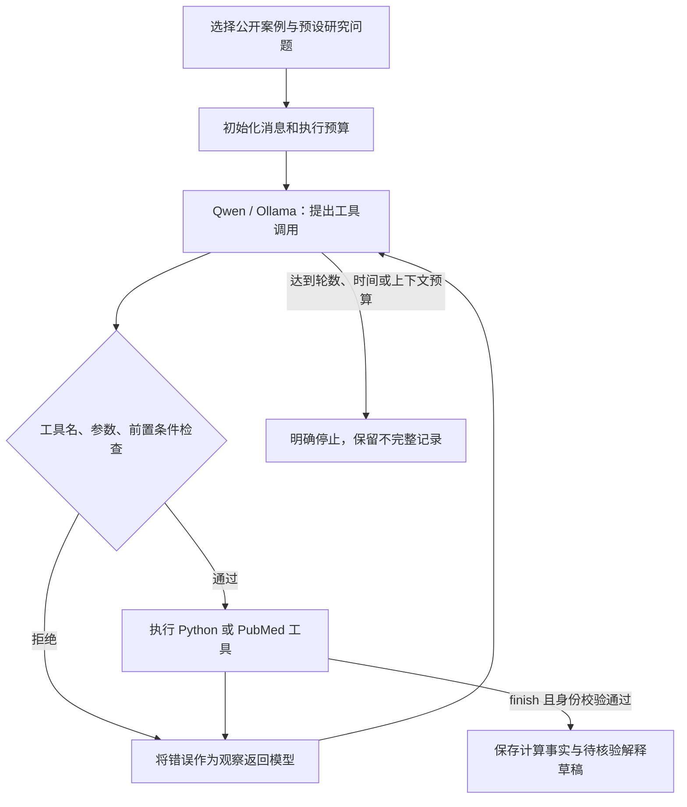

# Agent 工程：参考项目、当前实现与验收方式

更新：2026-10-23（新加坡日期）。这次改造针对一个具体缺口：旧版六个阶段都由 Python 按固定顺序调用，没有模型决定下一步。

## 从两个项目实际学到什么

| 项目 | 已阅读的核心实现 | 借鉴到本项目的设计 |
|---|---|---|
| [PilotDeck](https://github.com/OpenBMB/PilotDeck/blob/1732d07dc5f90cf243180b451c250e15f3a947ab/README.zh.md) | [`AgentLoop.ts`](https://github.com/OpenBMB/PilotDeck/blob/1732d07dc5f90cf243180b451c250e15f3a947ab/src/agent/loop/AgentLoop.ts)：模型路由、调用收集、工具执行、结果配对、轮数限制、事件；自行实现 TypeScript 运行时 | 模型调用与工具执行分层；明确停止条件；事件来自实际执行 |
| [OpenWorker](https://github.com/andrewyng/openworker/blob/7bac273885d77f5794416ba7da5ad4ab4ceafd5f/README.md) | [`engine.py`](https://github.com/andrewyng/openworker/blob/7bac273885d77f5794416ba7da5ad4ab4ceafd5f/coworker/engine.py) 的 `_loop` / `_execute_sync`，以及 [`providers/base.py`](https://github.com/andrewyng/openworker/blob/7bac273885d77f5794416ba7da5ad4ab4ceafd5f/coworker/providers/base.py) 的 ProviderClient / AssistantTurn | 模型适配器只返回一次响应；运行时负责循环，工具注册表负责执行；权限不能由模型自授 |

OpenWorker 的 README 介绍 aisuite，但所读版本的执行循环位于自己的 Engine，模型通过 ProviderClient 接口接入。不能只看 README 就把工程等同于某个库。PilotDeck 也是自建运行时，而不是简单套一个通用编排框架。

只借鉴职责划分，未复制这两个项目的源码；PilotDeck README 标注 AGPL-3.0，OpenWorker 标注 MIT。没有实测它们的产品性能，也不引用其营销性能数字作为本项目证据。

## 我们现在用什么

| 层次 | 实现与边界 |
|---|---|
| Agent 框架 | **LangGraph 1.2.16**，`StateGraph`；两个节点 `model`、`tools` 与条件边；版本锁在 uv.lock |
| 大模型 | 已安装的 **Qwen3.5 4B**，经本机 **Ollama** `/api/chat`；实际 HTTP 请求，不是脚本回放 |
| 模型适配器 | `OllamaProvider.chat(messages, tools)`；单次调用；后续可按 Provider 协议接其他已验证服务 |
| 工具 | `inspect_dataset`、`analyze_dataset`、`search_pubmed`、`read_abstract`、`finish_investigation` |
| 参数与权限 | Pydantic 禁止额外参数；仅两个内容指纹已校验的公开案例；没有 shell、任意 Python、任意文件路径工具 |
| 数值来源 | pandas / scikit-learn；沿用真实切分、基线、模型评估、置换重要性 |
| 状态 | LangGraph 内存状态包括 messages、turns、pending、done、reason；磁盘保存事件、工具产物与报告 |
| 可观察性 | 模型轮次、工具名、参数、返回值、耗时、可用时的 token 计数；不展示或保存隐藏思维链 |
| UI / API | Next.js `/agent` → FastAPI `/api/agent/*` → 单并发受限子进程 |

这里选择 LangGraph，是因为我们现在确实有“模型→工具→观察→模型”的循环和条件退出；先前固定顺序流程不需要为名字而引入它。参考 [LangGraph 官方 Quickstart](https://docs.langchain.com/oss/python/langgraph/quickstart) 和 [Ollama 工具调用协议](https://docs.ollama.com/capabilities/tool-calling)。



程序规定“分析前必须读数据、结束前必须分析和尝试检索”，防止跳过必要工作。模型选择具体调用、检索词、要读的 PMID、需要重查还是结束；它不自由编写统计代码。**目前是一个研究 Agent 调用多个工具，不是六个独立 Agent，也不是任意研究任务都可完成。**

## 如何看到真实 Demo

先按 README 启动应用，再打开 [Agent 演示](http://127.0.0.1:3018/agent)。

1. 页面列出框架、模型、工具和本机模型可用性。
2. 选心脏病或乳腺癌公开案例，点击“启动真实 Agent”。如果数据未准备，先回原工作台加载对应公开案例。
3. 每轮出现模型调用；动作卡展开显示实际参数和返回值，检索词由模型产生。
4. 完成后，查看 Python 指标、模型选择讨论的特征、待核验解释、实际打开的引用。
5. 刷新或选择历史记录，查看保存的执行证据。历史记录明确标为保存结果，不伪装成实时推理。

命令行入口（需要已有模型和已校验案例；不自动下载模型）：

```bash
ollama list
uv run python -m scripts.fetch_public_data --help
# 若尚未准备数据，按脚本帮助下载相应公开案例，或从工作台加载。
uv run python -m scripts.run_agent --example heart
```

运行产物位于 `data/agent-runs/<UUID>/`：trace.json、messages.json、analysis.json、search-N.json、report.json。网页入口另有 status.json。目录被 Git 忽略；不提交用户运行内容。报告中的 dataset_sha256 和事件中的 runtime_sha256 可定位输入与运行时代码版本。

## 为什么运行成功仍然不够

首个真实运行 `a5d35ce9-84b7-416f-a2ba-b3f846e5813d` 用六轮模型调用完成了检查、分析、检索、阅读两篇摘要和生成草稿。但复核发现：

- 模型把 `ca` 误解成“钙化血管数”，据此生成含 calcium 的检索词。[UCI 原始定义](https://archive.ics.uci.edu/dataset/45/heart+disease)是透视检查中显影的主要血管数。
- PMID 10895404、9197430 确实被检索并打开；这不意味着它们支持草稿对所有特征的解释。

保留原始记录，另外写入 engineering-review.json 展示开发时发现的问题；这不是自动 Critic 的成果。已补充数据字典与模型提示消除 `ca` 歧义，但**提示修改不能证明幻觉问题全面解决**。最新实跑结果见 [Agent 验收记录](agent-acceptance.md)。

当前自动检查仅保证工具边界、已有特征名和已读引用身份；自由文本解释中的数字、语义、文献支持关系尚未自动核验。因此结果状态是 `completed_draft` / `unverified_model_draft`，不标成“科学审核通过”。

## 有限执行与剩余工程工作

- 最多十轮模型响应、十六次工具调用、两次 PubMed 搜索；超出后保留不完整状态。
- 单次 Ollama 请求超时 90 秒；每次调用前检查 360 秒软预算，网页子进程总时限 450 秒。
- 网页启动只允许一个 Agent 进程，并使用环境变量白名单，避免继承付费 API 与跟踪服务凭据。
- 模型服务不可用直接失败，不下载权重、不改用付费服务、不制造工具结果。
- 日志与产物可查看，但**尚无 LangGraph checkpoint 恢复**；中断需重新执行。两个入口各自单并发，尚未统一资源调度。
- 下一步应实现结构化主张/逐句来源核对，以及字段语义、证据相关性和检索策略的专门评估；不是继续增加 Agent 名称。

## 测试具体保护什么

`tests/test_agent_runtime.py` 使用明确标记的脚本提供方测试控制逻辑，不能作为模型能力证据：

- 模型请求执行任意 Python：工具白名单拒绝，错误返回模型，允许预算内纠正。
- 模型填写未检索或未阅读的 PMID：不允许写入最终引用。
- 文献服务失败：结果仍明确没有外部证据，不能凭空补引用。
- 模型重复请求不存在的工具：十轮后停止，不无限循环。
- 模型响应被截断：不执行半截参数。

`frontend/e2e/agent.spec.ts` 将离线 UI 故障验证与显式开启的真实 Ollama + PubMed 网页运行分开。是否具备科研解释能力，要看真实任务中的错误和证据，不以测试数量替代。
