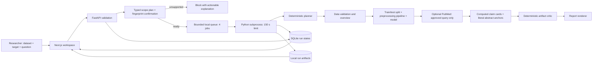

# Architecture

## Responsibilities and state

Six stages have explicit running/complete/failed events with UTC timestamps and tool summaries. No chain-of-thought is generated or displayed. Each run follows an acyclic sequence, with one review pass. PubMed requests have 12-second timeouts, up to two attempts per request and conservative pacing. A retrieval failure leaves model results available with a visible failed retrieval event. Analysis/verification failures block report generation.

The API supervises one subprocess at a time. At most four jobs occupy queue slots. The subprocess deadline bounds CPU/network work. Fixed code paths and validated scalar parameters replace generated Python. Uploaded/retrieved text is data, never instructions. UUIDs identify artifacts; request strings cannot choose filesystem paths or URLs. Browser origin/host checks reduce unwanted browser access but are not a substitute for user authentication.

## Numerical contract

Exact duplicate rows and missing-target rows are removed, then rows split 75/25 with fixed seed 42 (stratified for classification). Training-only heuristics remove identifiers, constants, high-cardinality text and obvious outcome copies. Imputation and one-hot encoding live inside a sklearn Pipeline and are refitted per training CV fold. A 100-tree forest is compared with a dummy baseline on the separate holdout. Balanced accuracy/F1 and binary ROC-AUC/AP are used for classification; RMSE/MAE/R² for regression. Positive label is reported explicitly. Three-fold training CV uses sklearn's higher-is-better negative RMSE convention for regression.

Permutation importance shuffles original columns in the holdout eight times. Means and shuffle SDs are persisted, including negative importance. Ranking on the holdout is exploratory, not independent validation of a subsequently selected feature subset. Supervised leakage screening is performed on outer training rows, so inner CV is conditional on that feature screen; no test target informs selection.

## Evidence model

- Dataset observations: schema, missingness, duplicates, exclusions.
- Computations: analysis-1 and factor-N records, split indices, seed, versions and dataset SHA-256.
- Retrieved sources: pubmed-PMID records with URL, DOI if provided, authors, year, abstract access scope and retrieval timestamp.
- Hypotheses: no clinical/causal hypotheses promoted to findings. Literature support/contradiction remains uncertain.

The report renders these artifacts directly. Critic checks finite metrics, disjoint partitions and source-ID consistency; it does not impersonate semantic peer review. Original uploads and results persist locally under ignored data/. No patient records are bundled.

`POST /api/plans` returns typed checks, steps, limitations and a SHA-256 fingerprint of the normalized request, dataset content and plan version. `POST /api/runs` always recomputes scope checks and rejects a stale supplied fingerprint before queueing; direct API clients may omit the optional confirmation fingerprint but cannot bypass scope validation. The worker checks the dataset hash again. Unsupported explicit purposes/designs and a limited set of question/field patterns are blocked. This is conservative deterministic scoping, not general semantic understanding or proof of independence.

The checksum-identified public-example catalog supplies reviewed targets, source attribution, field labels and curated lexical search terms. An explicit example load calls a fixed UCI downloader; failure is visible and no synthetic fallback is used. User upload filenames do not establish provenance. Downloaded examples live in project `data/public/`; per-run uploads/artifacts use `OPENRESEARCH_DATA_DIR`.

`claims.json` binds each factor to its numeric value, scoring metric, test size and `analysis.json#/factors/N`. Literature anchors have retrieved source IDs, literal abstract character ranges, quotes and abstract digests. A second pass rejects changed values, template wording, pointers, source IDs or quotes. Matching is lexical only; relation is `unassessed`, or `insufficient` if no anchor. Neither state implies scientific support or conflict. The UI exposes both computation and source snippets in one card; exports include the same evidence.

The Chinese UI requires preview before run, invalidates previews when input changes and restores saved runs via a locally remembered UUID. `GET /api/history` returns the latest 20 local run summaries. Polling pauses after five consecutive failures and offers an explicit retry. No private question or data rows are placed in browser storage.

## Extension boundaries

Provider protocol is declared but disabled. A verified provider could propose a typed plan or candidate source assessments; deterministic tools and evidence validation must remain authoritative. Sponsor adapters are pending tenant contracts/access. Zetaris should supply a read-only selected dataset with query provenance; Meterless could manage trusted research memory. A prototype hash embedder must never be described as model inference. No LangGraph dependency until branches, retries or human review justify it.
