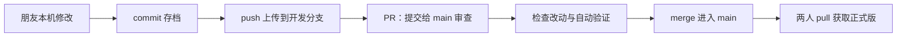

# 两个人如何用 GitHub 协作

更新：2026-10-23。仓库：[tired-wind/openresearch-agent](https://github.com/tired-wind/openresearch-agent)。

## 朋友这次说的是什么意思

“要求套件和环境都接好了，push 上去了，你可以 merge 后继续，日志写了”对应的是：

1. 朋友在自己的 Windows 电脑安装并测试了相关服务，写了适配代码。
2. 他把代码提交并上传到 GitHub 的 `znh/dev` 分支。`push` 是上传提交。
3. `main` 是大家共用的正式版本；他的改动还需审查并合入 `main`，这叫 `merge`。
4. 交接日志在 [docs/dev-log-2026-10-23.md](dev-log-2026-10-23.md)。日志描述的是他那台电脑的状态，服务和密钥不会随代码上传到你电脑。

检查时发现 GitHub 尚无打开的 PR。维护者从 `znh/dev` 建立 `integrate/znh-sponsor-adapters` 集成分支，保留朋友的提交，再补复核修复后走 PR；没有改写朋友的开发分支。

## 本次合入的成果与检查

朋友贡献：Zetaris SQL 适配器与检查脚本、Meterless Nightshift / Nemotron 模型适配器、H-MEM 风格的词法记忆实现与研究循环接入、Windows 数据文件换行校验修复、开发日志。

维护者补充的合并检查：

- 网页任务禁止从磁盘重新读 `.env`，明确使用 Ollama 并关闭记忆。
- CLI 默认使用 Ollama；云端服务需要显式选择 `--provider nightshift`，环境文件需显式 `--env-file .env`，记忆需显式 `--memory-dir`。
- Agent 的 Nightshift 响应必须标明并匹配固定模型；截断响应不执行工具。
- SQL 检查拦住多语句、注释、隐藏写入及非法行数；仍需服务端只读账号。
- 保留已有公开案例页面和实际运行记录；运行时错误不会伪装成成功。

本机执行的是离线回归、前端构建和原工作流检查。朋友日志中的 Windows Zetaris/Nightshift 连接及云端实跑是**贡献者报告**，尚未在 Mac 重现。本机未安装他的 Docker 环境、未下载大模型，也未调用其付费或云端推理。

仍待做：网页选择 Nightshift 和显示记忆、Zetaris 数据真正进入分析、逐条科学语义核验、赞助商合规复查、提交演示材料。代码合并不等于这些服务已经部署在所有机器。

## 先记住五个词

| 词 | 这次项目里的意思 |
|---|---|
| repository / repo | 整个项目仓库，包括代码、文档和修改历史 |
| branch | 一个开发分支；`main` 是正式版，`znh/dev` 是朋友的开发线 |
| commit | 一次有说明、可追踪的修改存档 |
| push / pull | push 把本地提交上传；pull 把 GitHub 的提交下载合入本地 |
| PR / merge | PR 提出合并并供审查；merge 才把改动纳入目标分支 |

## 下次在网页上怎么操作

1. 打开仓库，点击 **Pull requests** → **New pull request**。
2. 设 **base: main**（准备接收改动），**compare: znh/dev**（朋友提供改动）。不要把方向选反。
3. 看 **Files changed**，确认改动内容，再填写说明并点 **Create pull request**。
4. 等 `verify` 变绿，阅读审查结果。红色表示需要处理；绿色只表示规定的检查通过，不代表产品或科研结论一定正确。
5. 确认要接收这批改动，点 **Squash and merge** → **Confirm squash and merge**。项目主分支保护要求先通过 PR。

若朋友已建 PR，直接打开即可，无需重复创建。若维护者已经合并，本次不要再点一次相同分支；去 PR 的 **Merged** 状态确认结果。

依据：[GitHub 创建 PR](https://docs.github.com/en/pull-requests/how-tos/create-pull-requests/creating-a-pull-request)、[合并 PR](https://docs.github.com/en/pull-requests/how-tos/merge-and-close-pull-requests/merging-a-pull-request)。

## 怎么让朋友看到成果

- 直接把仓库链接发给他：默认展示合并后的 `main`、中文 README、Agent 截图和文档。
- 用 PR 链接看本次改了哪些文件、谁提交的、检查结果和合并状态。
- 想运行最新版：在自己的项目目录先执行 `git status`，有未提交改动先保留，再执行 `git switch main` 和 `git pull --ff-only origin main`。
- 后续另开新分支开发，例如 `git switch -c znh/next-task`。此示例是新分支名称，不必反复使用已经合并的旧分支。

**`http://127.0.0.1:3018/agent` 只指向打开者自己的电脑。** 将这个链接发给朋友，不会让他访问你的机器。他可以在自己电脑按 README 配置并运行；共享在线演示需要后续部署。

GitHub Actions 运行自动检查，并不托管这个 Next.js/FastAPI 应用。不要把“代码上传”理解为“网站已上线”。
